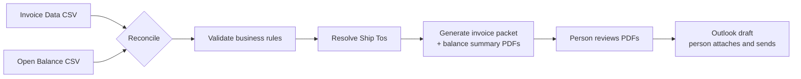
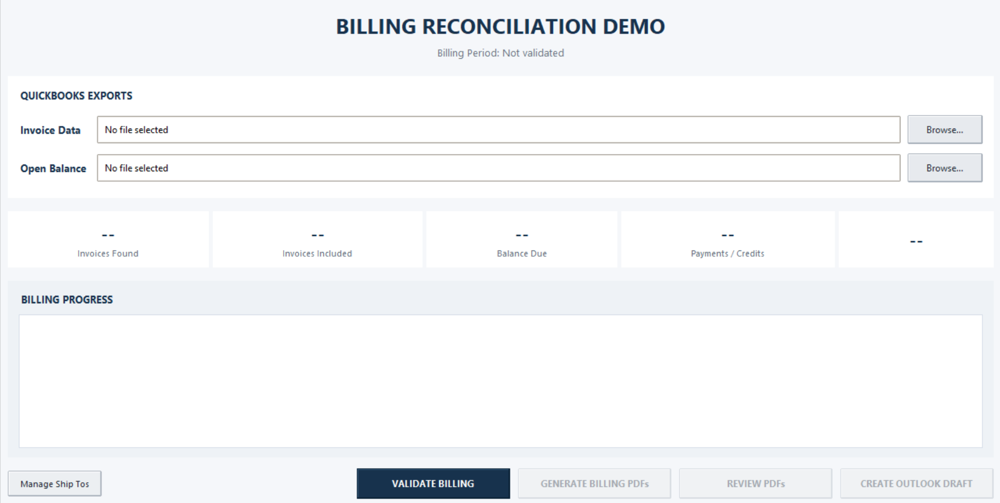
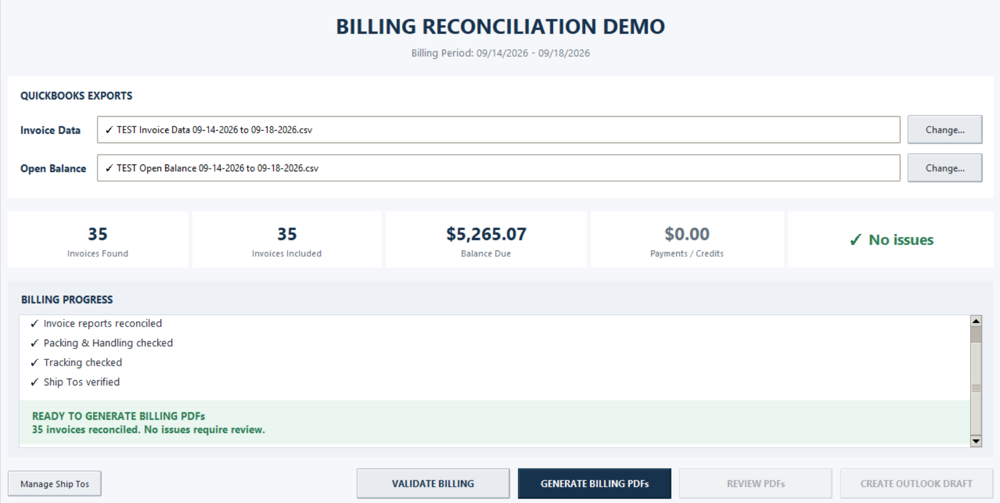
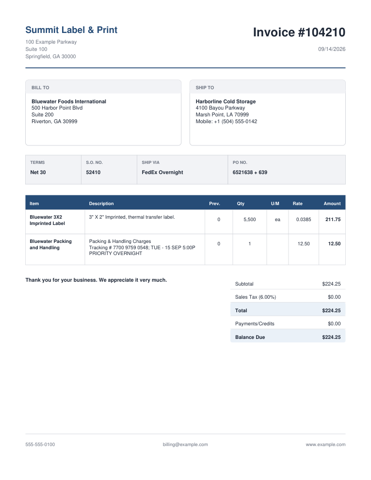
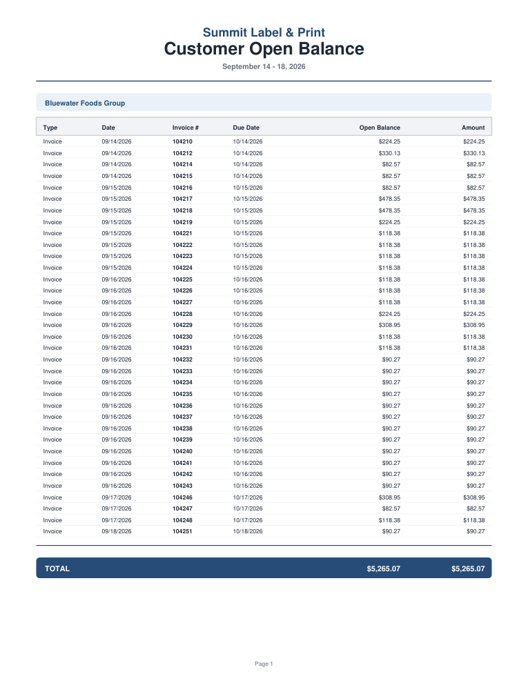

# Billing Reconciliation Demo

[](https://github.com/ShaynahCodes/billing-reconciliation-demo/actions/workflows/tests.yml)


A Windows desktop automation, built with **Python and Tkinter**, that reconciles two weekly QuickBooks exports, checks every invoice against the customer's billing rules and produces a review-ready invoice packet, open-balance summary and email draft. A person stays in control of every send.

> **Portfolio adaptation:** This repository is a privacy-safe adaptation of an internal billing automation I built for a real business workflow. Company names, customers, addresses, recipients, invoice data and other identifying details have been replaced with fictional equivalents. It does not connect to QuickBooks.

## Impact

**Weekly billing time: about 2 hours → 10–15 minutes**, compared with the manual process it replaced.

## The problem

Every week, one customer's open invoices had to be billed as a single packet. By hand that meant:

1. Exporting two QuickBooks reports and comparing them line by line to find which invoices were still open
2. Checking each invoice for the right packing and handling charge, tax and FedEx tracking number
3. Working out each full Ship To address, which QuickBooks exports split across columns inconsistently
4. Rebuilding every invoice and an open-balance summary as PDFs
5. Writing the email with the right recipients, subject and attachments

Done by hand, this took about two hours every week.

## The solution



The bot does the comparing, checking and formatting. A person handles the judgment calls: unclear addresses, missing tracking and the final send.

### Validation rules

Every problem is sorted into one of three levels, so the reviewer knows exactly what needs attention.

| Level | What happens | Checks |
|---|---|---|
| **Stop** | PDFs can't be generated until it's fixed | Invoice total differs between the two reports · open invoice missing from Invoice Data · open balance higher than invoice total · wrong packing item, rate or amount · invoice dated outside the billing week · billing period isn't Monday–Friday · wrong customer · credit memo present · duplicate rows |
| **Warning** | Allowed through, flagged for review | Missing tracking number · nonzero sales tax · missing or extra packing line |
| **Pause for a person** | The bot asks instead of guessing | Ship To address with no confident unique match · week already billed (asks before generating again) |

Paid invoices are excluded automatically, and partial payments are calculated from the original total and the current open balance.

### Ship To matching

QuickBooks exports the same warehouse differently from week to week. The bot keeps a library of verified full address blocks and auto-matches only when one saved address is a clear, unique match. Two sites with the same company name and street are left for a person to choose. Every address a person confirms is remembered for future weeks.

## Application preview

### Before validation



### After validation

With the included sample exports, the app reconciles **35 invoices** with a **$5,265.07 balance due** and no issues, unlocking **Generate Billing PDFs**.



### Generated PDFs

| Invoice packet (35 pages) | Open-balance summary (1 page) |
|---|---|
|  |  |

## Quick start (Windows)

**Requirements:** Python 3.10+ with Tkinter (included with the python.org installer). No pip packages.

1. Clone or download this repository.
2. Double-click **`Billing Reconciliation Demo.pyw`**, or run:
   ```powershell
   py "Billing Reconciliation Demo.pyw"
   ```
3. Browse to the two files in `TEST_DATA/` and click **VALIDATE BILLING**.
4. Expected: **35 found**, **35 included**, **$5,265.07** balance, **$0.00** payments/credits, no errors or warnings.
5. Click **GENERATE BILLING PDFs**, choose a folder, then **REVIEW PDFs**.
6. The Outlook draft uses fictional `example.com` recipients. Don't send real mail from the demo.

The full walkthrough is in the [User Guide](docs/USER_GUIDE.md).

## Tests

```powershell
py -m unittest discover -s tests -v
```

15 tests run automatically on Windows with Python 3.10 and 3.12 on every push. Each failure-case test copies a clean sample export, introduces one realistic mistake and checks that the bot reports it at the right level:

- Clean 35-invoice week reconciles exactly
- Amount mismatch, open balance above total, missing invoice, credit memo, wrong packing rate and out-of-week date all stop the run
- Missing tracking and unexpected sales tax produce warnings only
- Paid invoices are excluded and partial payments are calculated
- An already-billed week is detected
- An ambiguous Ship To is left for a person, and a distinct one is matched
- Both PDFs are generated and structurally valid

Tests use a temporary data folder and never send email.

## Repository structure

```text
billing-reconciliation-demo/
├── Billing Reconciliation Demo.pyw   # App: reconciliation, validation, PDF writer, Tkinter UI
├── config.json                       # Business rules, PDF names and recipients (fictional)
├── TEST_DATA/
│   ├── TEST Invoice Data ... .csv     # 35 sample invoices in QuickBooks export format
│   ├── TEST Open Balance ... .csv     # Matching open balances
│   └── demo_ship_to_master.json       # Clean Ship To library
├── tests/test_billing.py              # Regression tests (unittest)
├── docs/
│   ├── USER_GUIDE.md                  # Step-by-step workflow
│   └── *.png                          # Screenshots and sample output
├── .github/workflows/tests.yml        # Automatic test runs
└── CHANGELOG.md
```

`data/`, `logs/` and generated PDFs are created locally on first run and ignored by Git.

## Tech stack

**Python** · **Tkinter / ttk** · `csv` · `decimal` for exact money math · `dataclasses` · `json` · `re` · `pathlib` · `unittest` · a built-in PDF writer with no third-party libraries · **GitHub Actions**
